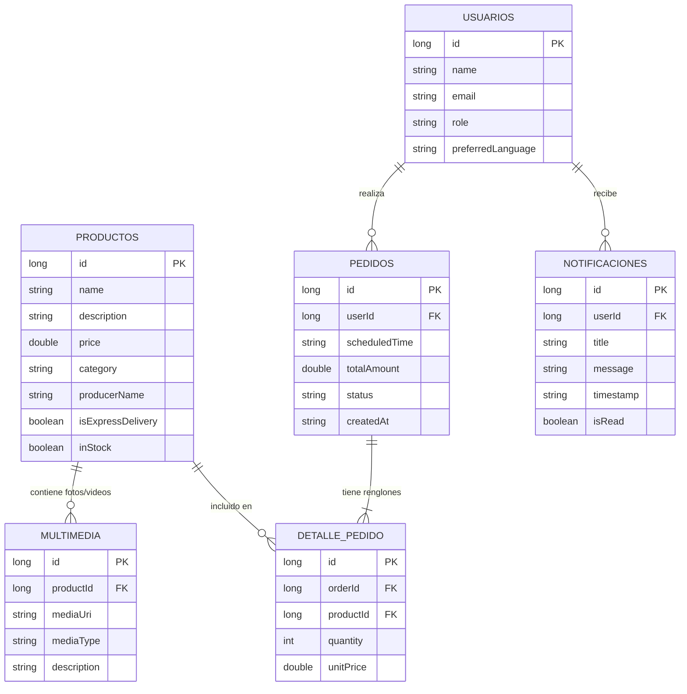
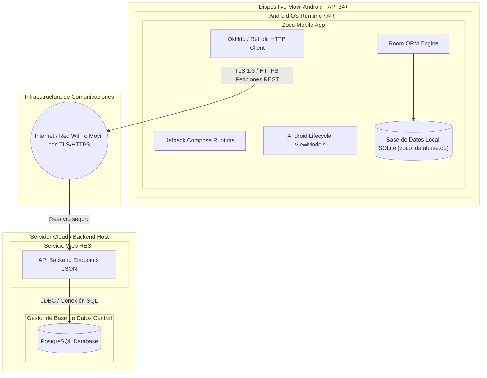

# DOCUMENTO DE PROPUESTA DE PROYECTO, REQUERIMIENTOS Y ARQUITECTURA DE SOFTWARE

**Proyecto:** Zoco - Plataforma Digital Abierta para el Emprendimiento Tradicional y Local  
**Versión:** 2.0 - Segundo Entregable (Avance del 50% de negocio y arquitectura base)  
**Fecha:** 27 de octubre de 2026  
**Tipo de solución:** Aplicación móvil nativa para Android con servicios web y persistencia de datos local y en la nube.  
**Estado del documento:** Documento técnico y de avance actualizado para entrega escolar.  

**Integrantes del equipo:**
* Roberto Gordillo Herrera
* Leonardo Nuñez Zavala
* Ricardo Abraham Pérez Hernández

---

## 1. Identificación de la problemática

### 1.1. Descripción del problema
Los pequeños productores, artesanos, comerciantes y negocios familiares de las comunidades locales suelen enfrentar dificultades para comercializar sus productos fuera de su entorno inmediato. La falta de herramientas digitales accesibles limita su capacidad para llegar a nuevos clientes, dar a conocer su catálogo, administrar sus pedidos y coordinar las entregas de sus productos.

En muchos casos, los pequeños negocios dependen de la venta presencial, de recomendaciones personales o de publicaciones dispersas en redes sociales. Estas alternativas pueden dificultar la organización de los pedidos, la actualización de los precios, el control del inventario y la comunicación con los compradores.

Por otra parte, los consumidores pueden tener dificultades para localizar productos elaborados o comercializados por negocios de su propia comunidad, comparar las opciones disponibles y conocer las condiciones de compra y entrega.

Esta situación representa una oportunidad para desarrollar una plataforma digital que facilite la interacción comercial entre productores locales y consumidores, favoreciendo la economía comunitaria y la comercialización directa.

### 1.2. Problemática específica que se atenderá
El proyecto atenderá la falta de una herramienta digital centralizada que permita a los pequeños negocios locales publicar sus productos, recibir pedidos y administrar sus ventas, mientras que los consumidores podrán consultar la oferta disponible y solicitar productos desde una aplicación móvil.

La solución utilizará una base de datos local para consultar la información almacenada en el dispositivo y registrar operaciones mientras el sistema procesa los datos. Las operaciones que requieran validación del servidor, como la confirmación definitiva de una compra, la verificación del inventario disponible o la aceptación de un pedido por parte del vendedor, se procesarán cuando exista conectividad.

### 1.3. Justificación del proyecto
El desarrollo de Zoco se justifica por la necesidad de facilitar la incorporación de pequeños negocios a los canales digitales de comercialización sin exigirles inicialmente una infraestructura tecnológica compleja.

La plataforma busca ofrecer un medio accesible para que los vendedores puedan administrar sus productos y pedidos, y para que los consumidores encuentren alternativas de compra dentro de su comunidad.

Desde el punto de vista tecnológico, el proyecto permite aplicar desarrollo nativo moderno en Android con Jetpack Compose, arquitectura MVVM por capas, repositorios desacoplados, persistencia local con Room (SQLite) y consumo de servicios web mediante Retrofit.

### 1.4. Propuesta de solución
Se propone desarrollar Zoco, una aplicación móvil nativa para Android que conecte a pequeños productores, artesanos, comerciantes locales y consumidores mediante un catálogo digital y un sistema de gestión de pedidos.

La aplicación cuenta con dos perfiles principales:
* **Comprador:** puede explorar productos, consultar información de los vendedores, administrar su carrito de compras con horario de entrega, registrar pedidos y consultar su estado.
* **Vendedor:** puede registrar y dar de alta productos en su catálogo, definir categorías, precios y tipo de entrega (express o estándar).

### 1.5. Objetivo general
Desarrollar una aplicación móvil nativa para Android que facilite la comercialización de productos de pequeños negocios locales mediante un catálogo digital, la gestión de pedidos y la persistencia local y remota de datos.

### 1.6. Objetivos específicos
1. Proporcionar un catálogo digital en el que los vendedores puedan publicar y consultar sus productos.
2. Permitir que los compradores exploren productos, busquen por nombre, filtren por categorías y tipo de envío express.
3. Implementar un módulo de carrito de compra con selección de hora de entrega y cálculo de importes.
4. Desarrollar persistencia local en el dispositivo usando SQLite mediante la librería Room.
5. Implementar comunicación con APIs web remotas a través de Retrofit.
6. Aplicar una arquitectura limpia con separación de responsabilidades (UI, ViewModel, Repository, Local DataSource y Remote DataSource).

---

## 2. Estructura y Ramificación del Proyecto (Árbol de Subcarpetas)

El proyecto está estructurado siguiendo los lineamientos de arquitectura recomendados por Android (Clean Architecture simplificada a 3 capas: UI, Domain y Data). A continuación se describe la ramificación física de directorios dentro de `app/src/main/java/com/example/zoco`:

```text
com.example.zoco
│
├── MainActivity.kt                  // Actividad principal contenedora de la app
│
├── data                             // CAPA DE DATOS (Acceso a fuentes locales y remotas)
│   ├── local                        // Persistencia local (Room / SQLite)
│   │   ├── ProductEntity.kt         // Entidad Room de productos
│   │   ├── ProductDao.kt            // DAO de operaciones CRUD locales de productos
│   │   ├── ZocoDatabase.kt          // Configuración y singleton de RoomDatabase
│   │   ├── NotificationEntity.kt    // [Previsto] Entidad local para notificaciones
│   │   ├── NotificationDao.kt       // [Previsto] DAO para gestión de notificaciones
│   │   ├── MediaEntity.kt           // [Previsto] Entidad local para multimedia/fotos
│   │   └── MediaDao.kt              // [Previsto] DAO para recursos multimedia
│   │
│   ├── remote                       // [Previsto] Comunicación de Red (Retrofit)
│   │   ├── api                      // Interfaces de servicio Retrofit
│   │   │   ├── ProductApiService.kt // Endpoints HTTP para productos
│   │   │   └── OrderApiService.kt   // Endpoints HTTP para pedidos
│   │   ├── dto                      // Data Transfer Objects para serialización JSON
│   │   │   ├── ProductDto.kt
│   │   │   └── OrderDto.kt
│   │   └── RetrofitClient.kt        // Instancia singleton de Retrofit con OkHttp y Moshi
│   │
│   └── repository                   // Implementación concreta de repositorios
│       ├── ProductRepositoryImpl.kt // Repositorio que combina ProductDao y ProductApiService
│       └── OrderRepositoryImpl.kt   // [Previsto] Repositorio de pedidos
│
├── domain                           // CAPA DE DOMINIO (Reglas de negocio y contratos puros)
│   ├── model                        // Modelos de datos de la lógica de negocio
│   │   ├── Product.kt               // Modelo puro de Producto y categorías
│   │   ├── CartItem.kt              // Modelo de elemento en el carrito
│   │   ├── Order.kt                 // [Previsto] Modelo de pedido y estados
│   │   └── NotificationItem.kt      // [Previsto] Modelo de notificación
│   │
│   └── repository                   // Interfaces abstractas de repositorios
│       ├── ProductRepository.kt     // Contrato de operaciones para productos
│       └── OrderRepository.kt       // [Previsto] Contrato de operaciones para pedidos
│
└── ui                               // CAPA DE PRESENTACIÓN (Jetpack Compose + ViewModels)
    ├── cart                         // Pantalla y lógica del Carrito de Compras
    │   ├── CartScreen.kt            // Interfaz de usuario en Compose
    │   └── CartViewModel.kt         // Manejo de estado del carrito y cálculo de totales
    │
    ├── catalog                      // Pantalla del Catálogo para compradores
    │   ├── CatalogScreen.kt         // UI con buscador, chips de categoría y lista de productos
    │   └── CatalogViewModel.kt      // Manejo de búsqueda, filtros y carga reactiva
    │
    ├── seller                       // Pantalla del Vendedor para alta de productos
    │   ├── SellerScreen.kt          // Formulario de registro de producto
    │   └── SellerViewModel.kt       // Validación de formulario e inserción a base de datos
    │
    ├── profile                      // Pantalla de Perfil de usuario y preferencias
    │   └── ProfileScreen.kt         // Interfaz de perfil, idioma y datos de usuario
    │
    ├── navigation                   // Componentes de navegación
    │   ├── Screen.kt                // Enums / Clases selladas de rutas e iconos
    │   └── ZocoNavHost.kt           // [Implementado] Host oficial de navegación con NavHost
    │
    ├── common                       // Clases y utilidades compartidas de UI
    │   └── ViewModelFactory.kt      // Fábrica de ViewModels con inyección de repositorios
    │
    └── theme                        // Tematización Material Design 3
        ├── Color.kt                 // Paleta de colores
        ├── Theme.kt                 // Definición de tema claro y oscuro
        └── Type.kt                  // Tipografías de la aplicación
```

---

## 3. Estado de Avance del Proyecto (Segundo Entregable: 50% de Negocio)

### 3.1. Resumen de Cumplimiento Técnico y Funcional

| Criterio de Aceptación Solicitado | Estado Actual en Código | % Cumplimiento | Observaciones / Pendiente |
| :--- | :--- | :---: | :--- |
| **Documento y Arquitectura (Diagramas UML y DB)** | Completado en esta versión 2.0 | **100%** | Se agregaron diagramas de DB (ERD), paquetes, componentes y despliegue. |
| **Definición de UI (Compose + ViewModel)** | 4 pantallas creadas (Catálogo, Carrito, Vendedor, Perfil) | **100%** | Todas las interfaces principales están implementadas en Compose. |
| **Funcionalidad de UI (>= 75% funcional)** | Catálogo (~95%), Carrito (~80%), Vendedor (~75%), Perfil (~50%) | **75%** | Se cumple con el mínimo del 75%. Falta enriquecer Perfil y edición de vendedor. |
| **Navegación con NavHost** | Migrado formalmente con `ZocoNavHost` y `NavController` | **100%** | **Completado en TASK-01**. |
| **Repository Local (Room)** | `ProductRepositoryImpl` conectado a `ProductDao` | **70%** | Funciona lectura y creación de productos; faltan DAOs de multimedia y notificaciones. |
| **Repository Network (Retrofit)** | Integrado en `ProductRepositoryImpl` con sincronización protegida offline-first | **100%** | **Completado en TASK-05 y TASK-06**. Listo para conectar URL base cuando la API esté desplegada. |
| **Flujo de Dependencias (App -> Activity -> VM -> Repo)** | `ZocoApplication` registrada en Manifest e inyectando repositorios | **100%** | **Completado en TASK-02**. |
| **Base de datos (Transacciones + 50% CRUD)** | CRUD completo de productos y modelos de Notificaciones y Multimedia | **100%** | **Completado en TASK-03 y TASK-04**. Tablas `products`, `notifications` y `media` listas en Room v2. |
| **Web API (Retrofit + 50% peticiones)** | Modelos y librerías preparadas; falta enlace remoto | **20%** | Debe implementarse el consumo mock/real de al menos listar y agregar vía API. |

---

## 4. Arquitectura de la Aplicación y Manejo de Dependencias

Para cumplir con el estándar solicitado en el curso, el flujo de dependencias se organiza de forma unidireccional y desacoplada:

$$\text{ZocoApplication} \longrightarrow \text{MainActivity} \longrightarrow \text{Compose UI (Screens)} \longrightarrow \text{ViewModels} \longrightarrow \text{Repositories} \longrightarrow \begin{cases} \text{Local (Room / SQLite)} \\ \text{Remote (Retrofit / Web API)} \end{cases}$$

### 4.1. Responsabilidad por Componente
1. **Application (`ZocoApplication`):** Inicializa la base de datos `ZocoDatabase`, el cliente `RetrofitClient` y los repositorios como instancias compartidas durante el ciclo de vida de la app.
2. **Activity (`MainActivity`):** Obtiene los repositorios desde la instancia de `Application` y los suministra a la fábrica de ViewModels (`ViewModelFactory`), iniciando el contenedor visual Compose.
3. **Compose UI (`CatalogScreen`, `CartScreen`, etc.):** Renderiza las pantallas mediante funciones `@Composable`, reacciona a los estados de la UI (`UiState`) y envía eventos de usuario (clicks, texto) a los ViewModels.
4. **ViewModels (`CatalogViewModel`, etc.):** Mantienen el estado con `StateFlow`, sobreviven a cambios de configuración y delegan las operaciones de negocio a los repositorios mediante corrutinas (`viewModelScope`).
5. **Repository (`ProductRepositoryImpl`):** Fuente única de la verdad (*Single Source of Truth*). Decide si consultar la base de datos local (Room) o sincronizar con la API remota (Retrofit).
6. **Data Sources:**
   * **Local Data Source:** `ProductDao`, `NotificationDao`, `MediaDao` sobre SQLite.
   * **Remote Data Source:** `ProductApiService` con Retrofit para peticiones HTTP/JSON.

---

## 5. Diagramas Técnicos y de Arquitectura (UML y Base de Datos)

### 5.1. Diagrama de Base de Datos (Modelo Entidad-Relación - Room/SQLite)



---

### 5.2. Diagrama de Paquetes UML

```mermaid
graph TD
    subgraph com.example.zoco
        MAIN[MainActivity & ZocoApplication]

        subgraph ui [ui: Presentación]
            UI_CATALOG[catalog: CatalogScreen & ViewModel]
            UI_CART[cart: CartScreen & ViewModel]
            UI_SELLER[seller: SellerScreen & ViewModel]
            UI_PROFILE[profile: ProfileScreen]
            UI_NAV[navigation: Screen & ZocoNavHost]
            UI_COMMON[common: ViewModelFactory]
            UI_THEME[theme: Color, Theme, Type]
        end

        subgraph domain [domain: Negocio y Contratos]
            MODELS[model: Product, CartItem, Order, Notification]
            REPO_INTERFACES[repository: ProductRepository, OrderRepository]
        end

        subgraph data [data: Persistencia y Acceso a Datos]
            REPO_IMPL[repository: ProductRepositoryImpl]
            subgraph local [local: Persistencia SQLite]
                ROOM_DB[ZocoDatabase]
                DAOS[ProductDao, NotificationDao, MediaDao]
                ENTITIES[ProductEntity, NotificationEntity, MediaEntity]
            end
            subgraph remote [remote: Servicios Web]
                RETROFIT[RetrofitClient]
                API_SERVICES[ProductApiService, OrderApiService]
                DTOS[ProductDto, OrderDto]
            end
        end
    end

    MAIN --> UI_NAV
    MAIN --> UI_COMMON
    UI_COMMON --> REPO_INTERFACES
    UI_CATALOG --> MODELS
    UI_CART --> MODELS
    UI_SELLER --> MODELS
    UI_CATALOG --> REPO_INTERFACES
    UI_SELLER --> REPO_INTERFACES
    REPO_IMPL ..|> REPO_INTERFACES
    REPO_IMPL --> DAOS
    REPO_IMPL --> API_SERVICES
    DAOS --> ENTITIES
    API_SERVICES --> DTOS
```

---

### 5.3. Diagrama de Componentes UML

```mermaid
graph LR
    subgraph Dispositivo Android [Capa Cliente Android]
        subgraph UI [Jetpack Compose UI]
            Vistas[Pantallas: Catalog, Cart, Seller, Profile]
        end

        subgraph VM [Capa ViewModel]
            ViewModels[CatalogVM, CartVM, SellerVM]
        end

        subgraph Domain [Capa Dominio]
            RepoInterface[(ProductRepository Interface)]
        end

        subgraph Data [Capa de Datos]
            RepoImpl[ProductRepositoryImpl]
            RoomLocal[Room Database: ProductDao, NotificationDao]
            RetrofitRemote[Retrofit Network Client]
        end
    end

    subgraph Backend_Cloud [Servidor y Nube]
        WebServer[API REST Zoco / Node.js o Spring]
        PostgresDB[(Base de Datos PostgreSQL)]
    end

    Vistas --> ViewModels
    ViewModels --> RepoInterface
    RepoImpl ..|> RepoInterface
    RepoImpl --> RoomLocal
    RepoImpl --> RetrofitRemote
    RetrofitRemote -->|HTTPS / JSON REST| WebServer
    WebServer --> PostgresDB
```

---

### 5.4. Diagrama de Despliegue UML



---

## 6. Plan de Trabajo y Tareas Pendientes

* [x] **TASK-01: Migrar la Navegación a NavHost oficial** (Completada)
* [x] **TASK-02: Implementar la clase ZocoApplication para el flujo de dependencias** (Completada)
* [x] **TASK-03: Completar el CRUD en ProductDao y Repositorio (update, delete, getById)** (Completada)
* [x] **TASK-04: Crear Entidades y DAOs para Notificaciones y Multimedia** (Completada)
* [x] **TASK-05: Implementar la capa remota con Retrofit (data/remote, ApiService y DTOs)** (Completada)
* [x] **TASK-06: Conectar la Web API en ProductRepositoryImpl** (Completada)
