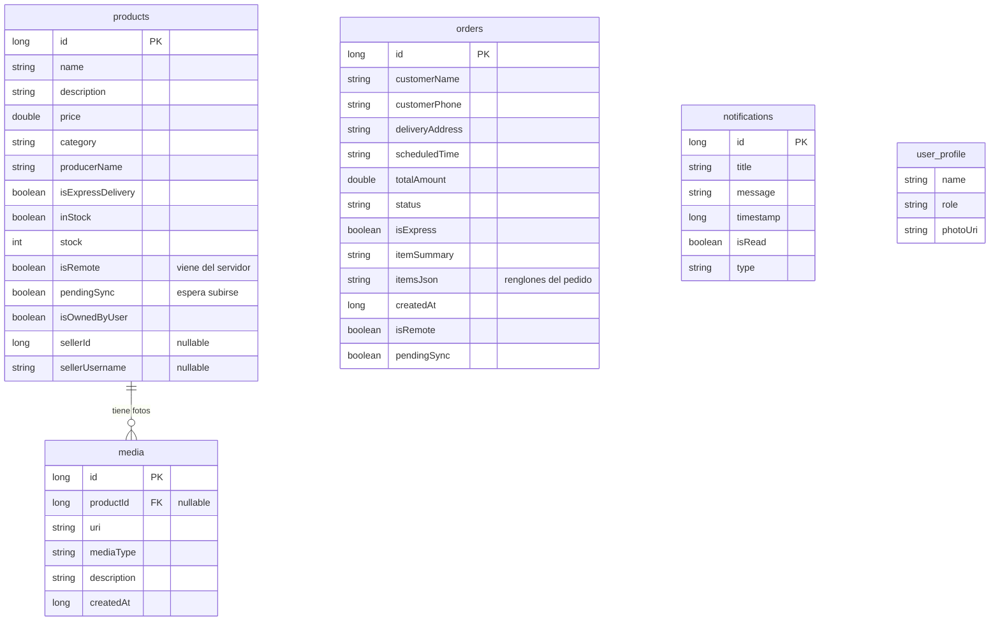
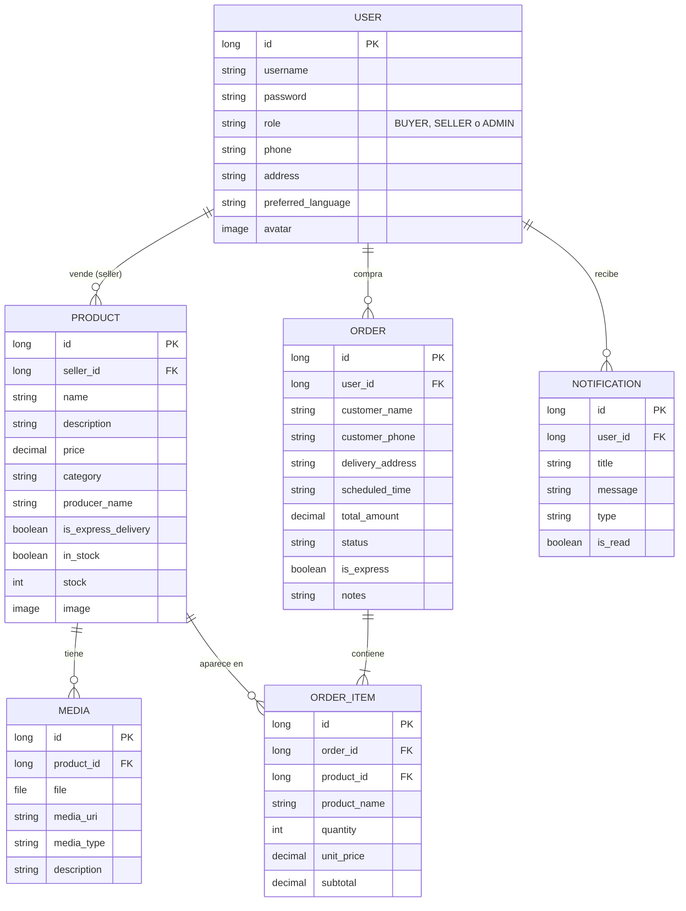
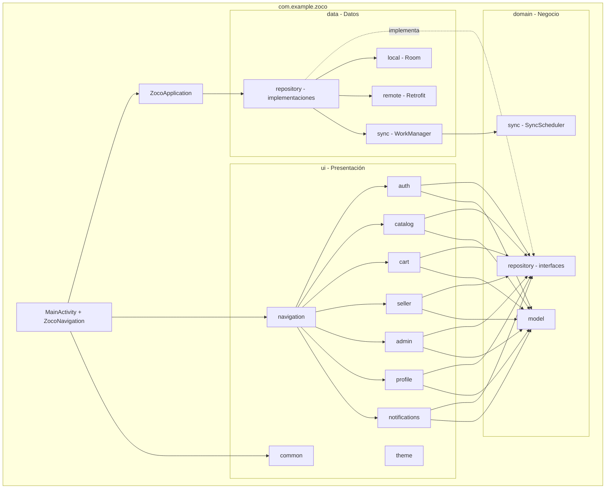
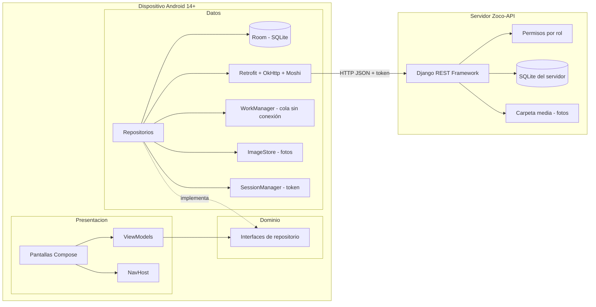
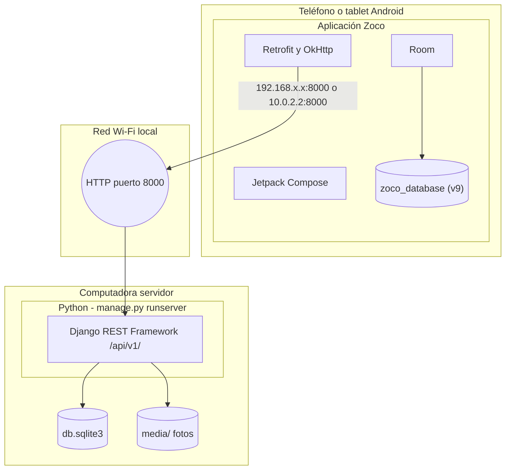

# DOCUMENTO DE REQUERIMIENTOS Y ARQUITECTURA DE SOFTWARE

**Proyecto:** Zoco - Plataforma Digital Abierta para el Emprendimiento Tradicional y Local  
**Versión:** 4.0 - Entregable Final  
**Fecha:** 26 de noviembre de 2026  
**Tipo de solución:** Aplicación móvil nativa para Android (Kotlin + Jetpack Compose) con base de datos local Room y servicio web REST propio (Django REST Framework).  

**Integrantes del equipo:**
* Roberto Gordillo Herrera
* Leonardo Nuñez Zavala
* Ricardo Abraham Pérez Hernández

**Repositorios:**
* Aplicación Android: `Zoco--Hyperlocal-E-commerce`
* Servicio web (API): `Zoco-API`

---

## 1. Problemática, solución y objetivos

### 1.1. Problema
Los pequeños productores, artesanos y negocios familiares tienen dificultades para vender fuera de su entorno inmediato: dependen de la venta presencial o de redes sociales, lo que complica los pedidos, el inventario y la comunicación. Los consumidores locales, a su vez, no tienen un lugar central donde descubrir la oferta de su comunidad.

### 1.2. Solución
**Zoco** es una aplicación móvil con tres tipos de cuenta:

| Rol | Cómo se obtiene | Qué puede hacer |
|---|---|---|
| **Comprador** | Se registra desde la app (es el único rol de registro) | Explorar y filtrar el catálogo, comprar, ver sus pedidos y notificaciones, cambiar contraseña, foto y nombre, pedir ser vendedor |
| **Vendedor** | Un comprador pasa a vendedor desde su perfil | Todo lo del comprador, más publicar y eliminar sus productos con foto y ver/actualizar los pedidos que recibe |
| **Administrador** | Lo crea el equipo manualmente en el servidor | Ver todos los usuarios, pedidos y productos, cambiar roles y moderar |

El inicio de sesión es obligatorio. La app funciona sin conexión con datos guardados en el teléfono (*offline-first*) y sincroniza con el servidor cuando hay red; la dirección del servidor se descubre sola.

### 1.3. Objetivos
* Interfaces completas en Jetpack Compose con Material Design 3, cada una gobernada por un ViewModel.
* Navegación declarativa con `NavHost`.
* Persistencia local con Room y consumo de una API REST con Retrofit.
* Experiencia distinta según el tamaño de pantalla (celular, plegable y tablet).
* Soporte de español e inglés con cambio de idioma en tiempo de ejecución.

---

## 2. Requerimientos

### 2.1. Funcionales

| ID | Requerimiento |
|---|---|
| RF-01 | Registro de compradores e inicio de sesión obligatorio con usuario y contraseña. |
| RF-02 | Tres roles (comprador, vendedor, administrador) con permisos distintos, validados también en el servidor. |
| RF-03 | Catálogo con búsqueda, categorías y filtro de entrega express. |
| RF-04 | Carrito, datos de entrega, horario y confirmación del pedido. |
| RF-05 | Historial de pedidos del usuario con su estado (pendiente, confirmado, en preparación, en camino, entregado, cancelado). |
| RF-06 | El vendedor publica productos con foto (galería o cámara), precio, existencias y categoría, y administra los pedidos recibidos. |
| RF-07 | El administrador gestiona usuarios (cambio de rol), pedidos y productos. |
| RF-08 | Perfil: nombre, foto, cambio de contraseña, idioma y cierre de sesión (que borra los datos locales del usuario). |
| RF-09 | Notificaciones con contador de no leídas y marcado como leídas. |
| RF-10 | Funcionamiento sin conexión: lo creado sin red se guarda en una cola y se sube al volver la conexión. |
| RF-11 | Descubrimiento automático del servidor en la red, sin escribir direcciones. |
| RF-12 | Cambio de idioma español/inglés sin reiniciar la aplicación. |

### 2.2. No funcionales

| ID | Requerimiento |
|---|---|
| RNF-01 | Android 14 (API 34) o superior. |
| RNF-02 | Arquitectura por capas (presentación, dominio, datos) con inyección manual de dependencias. |
| RNF-03 | Interfaz adaptable a tres clases de ancho: menor de 600 dp, de 600 a 839 dp y 840 dp o más. |
| RNF-04 | Todo texto visible al usuario vive en recursos (`strings.xml` en español e inglés). |
| RNF-05 | Pruebas unitarias de ViewModels, repositorios, permisos por rol y adaptación de pantalla. En el servidor, pruebas de la API. |

---

## 3. Arquitectura

### 3.1. Capas y flujo de dependencias

```text
ZocoApplication  ->  MainActivity  ->  ZocoApp (Compose)  ->  ZocoNavHost  ->  Pantalla
      │                                                                           │
 (crea una sola vez                                                          ViewModel
  base de datos, sesión,                                                          │
  repositorios)                                                              Repository (interfaz, dominio)
                                                                                  │
                                                              ┌───────────────────┴───────────────────┐
                                                     Fuente local (Room: DAO)            Fuente remota (Retrofit: ApiService)
```

* **`ZocoApplication`** es el contenedor de dependencias (*service locator*): construye una sola vez, de forma perezosa, la base de datos, el administrador de sesión, el descubridor del servidor y los repositorios.
* **`ViewModelFactory`** entrega a cada ViewModel los repositorios que necesita.
* Cada **repositorio** implementa una interfaz de la capa `domain` y coordina dos fuentes: la local (DAO de Room) y la remota (servicio Retrofit). Los ViewModels dependen solo de las interfaces, por eso las pruebas usan repositorios falsos.

### 3.2. Patrón de repositorio (local y remoto)

Cada repositorio de datos aplica el patrón *offline-first*:

1. **Lectura:** la interfaz siempre observa Room (`Flow`). El repositorio descarga del servidor y guarda en Room; la pantalla se actualiza sola.
2. **Escritura:** se guarda primero en Room. Si hay red se envía a la API; si no, queda marcada `pendingSync = true` y `SyncPendingWorker` (WorkManager) la sube cuando vuelve la conexión.
3. **Fallo de red:** nunca rompe la pantalla; se muestra lo guardado y un aviso comprensible.

| Repositorio | Fuente local (Room) | Fuente remota (Retrofit) |
|---|---|---|
| `ProductRepository` | `ProductDao`, `MediaDao` | `ProductApiService` |
| `OrderRepository` | `OrderDao` | `OrderApiService` |
| `NotificationRepository` | memoria (se descarga al abrir) | `NotificationApiService` |
| `UserProfileRepository` | `UserProfileDao` | `UserProfileApiService` |
| `AuthRepository` | `SessionManager` (sesión guardada) | `AuthApiService` |

### 3.3. Estructura de paquetes de la aplicación

```text
com.example.zoco
├── MainActivity.kt            // Única Activity: ZocoApp, reglas automáticas, idioma
├── ZocoNavigation.kt          // Barra inferior, columna de íconos, menú lateral, barra superior
├── ZocoApplication.kt         // Contenedor de dependencias
│
├── data
│   ├── local                  // Room v9: ProductEntity, OrderEntity, NotificationEntity, MediaEntity,
│   │                          //   UserProfileEntity + sus DAO + ZocoDatabase, SessionManager,
│   │                          //   ImageStore, SampleData
│   ├── remote                 // Retrofit + Moshi
│   │   ├── api                // AuthApiService, ProductApiService, OrderApiService,
│   │   │                      //   NotificationApiService, UserProfileApiService
│   │   ├── dto                // Objetos de transferencia JSON
│   │   └── …                  // RetrofitClient, ServerDiscovery, BaseUrl, NetworkConnectivityChecker
│   ├── repository             // Implementaciones (Auth, Product, Order, Notification, UserProfile)
│   └── sync                   // SyncPendingWorker, WorkManagerSyncScheduler (cola sin conexión)
│
├── domain
│   ├── model                  // Product, CartItem, Order, UserSession, UiMessage, …
│   ├── repository             // Interfaces de los repositorios
│   └── sync                   // SyncScheduler
│
└── ui
    ├── auth                   // AuthScreen, AuthViewModel (login y registro)
    ├── catalog                // CatalogScreen, CatalogFilters, ProductCards, ProductPurchase, CatalogViewModel
    ├── cart                   // CartScreen, CartCards, CartViewModel
    ├── seller                 // SellerScreen, SellerForm, SellerLists, SellerViewModel
    ├── admin                  // AdminScreen, AdminCards, AdminViewModel
    ├── profile                // ProfileScreen, ProfileSeller, ProfileSettings, ProfileViewModel
    ├── notifications          // NotificationsDialog, NotificationsViewModel
    ├── navigation             // Screen (rutas por rol), ZocoNavHost
    ├── common                 // WindowSize (tamaños), ViewModelFactory, UiMessageText, formato
    └── theme                  // Color, Theme, Type
```

### 3.4. Navegación
`ZocoNavHost` usa `NavHost` + `rememberNavController()` con cinco destinos: Catálogo, Carrito, Vender, Admin y Perfil. Las pestañas visibles dependen del rol (`Screen.visibleFor(role)`) y, si el rol cambia, la app regresa al Catálogo si la pestaña actual deja de estar permitida. Sin sesión, solo se muestra la pantalla de acceso.

### 3.5. Servicio web (Zoco-API)
Django 5.2 + Django REST Framework, autenticación por token, base SQLite, imágenes con Pillow. Aplicaciones: `accounts` (usuarios, roles, perfil), `products`, `orders`, `multimedia`, `notifications`. Los permisos por rol están en `accounts/permissions.py`.

Endpoints principales (`/api/v1/`): `auth/register`, `auth/login`, `auth/logout`, `auth/change-password`, `auth/me`, `auth/me/avatar`, `auth/become-seller`, `products`, `orders`, `multimedia`, `notifications` (incluye marcar todas como leídas) y `users` (solo administrador).

---

## 4. Diagramas

### 4.1. Base de datos local (Room v9, SQLite del teléfono)



Los renglones de cada pedido se guardan como JSON en `orders.itemsJson`, por eso no existe una tabla de detalle local. `user_profile` guarda un único registro. La sesión (token, usuario y rol) está en `SharedPreferences` mediante `SessionManager`.

### 4.2. Base de datos del servidor (Django)



### 4.3. Diagrama de paquetes



### 4.4. Diagrama de componentes



### 4.5. Diagrama de despliegue



El emulador alcanza el servidor con `10.0.2.2` (o con `adb reverse tcp:8000 tcp:8000`); un teléfono real usa la IP de la computadora en la misma red, y la app la descubre sola con `ServerDiscovery`.

---

## 5. Soporte de factores de forma (UX por tamaño)

Un solo cálculo (`WindowSize`) clasifica el ancho disponible y lo reparte a todas las pantallas:

| Clase | Ancho | Navegación | Ejemplo de diseño |
|---|---|---|---|
| Compacta | menor de 600 dp | Barra inferior | Lista de una columna; pantalla de acceso a una columna |
| Mediana | 600 a 839 dp | Columna de íconos (*NavigationRail*) | Catálogo en rejilla; carrito y perfil a dos columnas |
| Expandida | 840 dp o más | Menú lateral permanente con nombre, rol y notificaciones | Catálogo con panel de detalle a la derecha; carrito a dos columnas; vendedor con formulario y listas lado a lado; administración a tres columnas; acceso con panel de marca |

Un teléfono en horizontal (alto menor de 480 dp) también usa la columna de íconos. El panel de detalle del catálogo solo aparece si el contenido mide al menos 800 dp de ancho.

## 6. Soporte de idiomas

* Español (`res/values/strings.xml`) e inglés (`res/values-en/strings.xml`), con las mismas 179 cadenas.
* Los mensajes que nacen en un ViewModel (confirmaciones, errores de validación o de red) se guardan como `UiMessage` (identificador de recurso + argumentos) y se traducen al mostrarse, de modo que cambian de idioma junto con la pantalla.
* El selector de idioma está en Perfil; la elección se guarda y se aplica de inmediato (`LocaleManager`), sin reiniciar.

---

## 7. Matriz de cumplimiento

| Criterio de aceptación | Estado | Evidencia |
|---|---|---|
| Documento de requerimientos y arquitectura (BD y UML) | Completo | Secciones 2 a 4 de este documento. |
| 100% de las UI (Compose + ViewModel) | Completo | 7 pantallas, cada una con su ViewModel: acceso, catálogo, carrito, vendedor, administración, perfil y notificaciones. |
| Navegación (NavHost) | Completo | `ZocoNavHost.kt`, destinos por rol. |
| Repository local (Room) | Completo | `ProductDao`, `OrderDao`, `MediaDao`, `NotificationDao`, `UserProfileDao` usados por los repositorios. |
| Repository de red (HTTP) | Completo | Cinco `ApiService` de Retrofit usados por los repositorios, con reintento en cola. |
| Arquitectura y dependencias | Completo | `ZocoApplication` → `MainActivity` → Compose → ViewModel → Repository → Room / Retrofit. |
| Base de datos local | Completo | Room v9: 5 entidades, 5 DAO, migraciones. |
| Web API | Completo | Retrofit contra Django REST propio, con autenticación por token y roles. |
| Distintos tamaños de pantalla | Completo | Sección 5; probado en emulador de celular y tablet. |
| Distintos idiomas | Completo | Sección 6. |
| Integración del código de cada integrante | Completo | Historial de git de ambos repositorios con commits de los tres integrantes. |

## 8. Pruebas

* **Aplicación:** pruebas unitarias de ViewModels (catálogo, carrito, vendedor, perfil), repositorio de productos, mapeo de entidades, permisos por rol y adaptación de pantalla. Se ejecutan con `gradlew testDebugUnitTest`.
* **Servidor:** 50 pruebas de la API (registro, inicio de sesión, permisos por rol, cambio de contraseña, notificaciones, pedidos, datos de ejemplo). Se ejecutan con `python manage.py test`.

## 9. Limitaciones conocidas

* El servidor está en configuración de desarrollo (`DEBUG` activo, clave fija, sin HTTPS).
* El token de sesión se guarda en `SharedPreferences` sin cifrar.
* No hay pruebas de interfaz instrumentadas.
