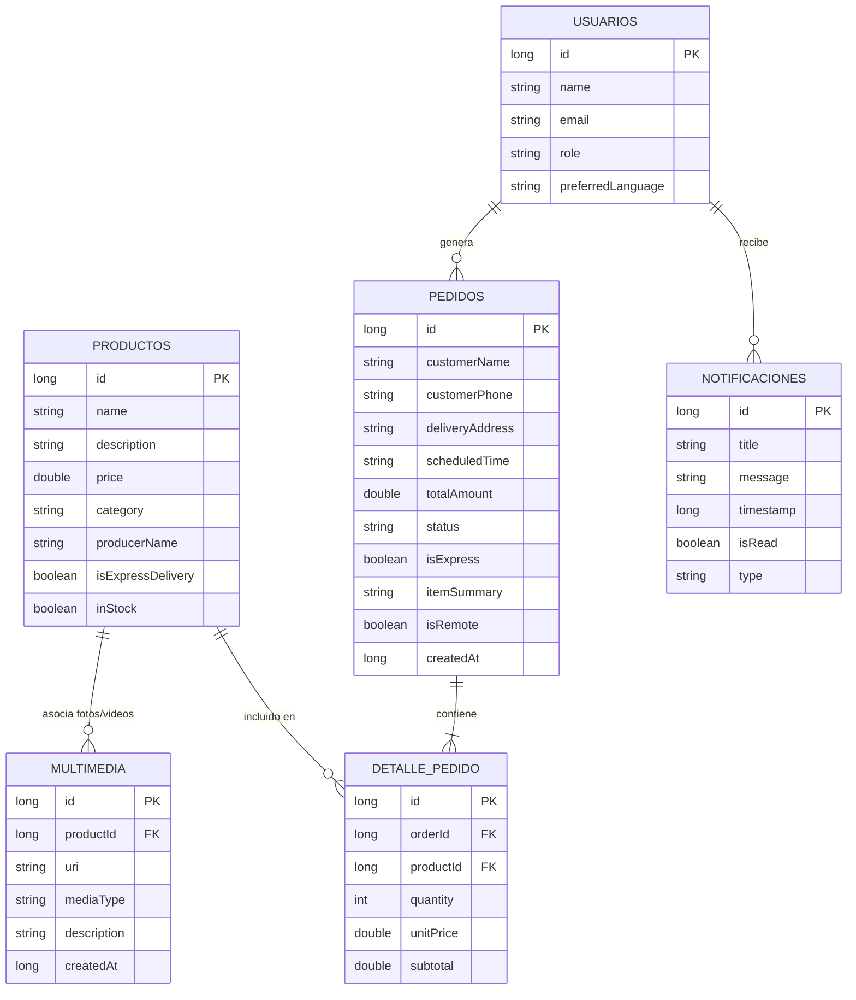
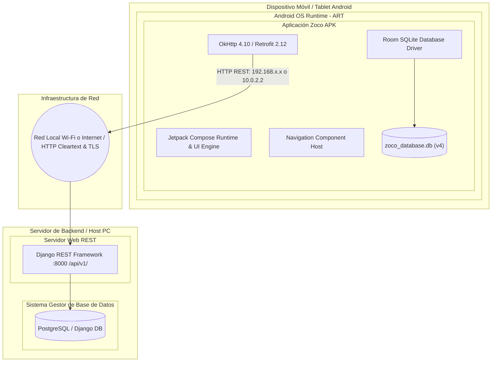

# DOCUMENTO DE REQUERIMIENTOS Y ARQUITECTURA DE SOFTWARE

**Proyecto:** Zoco - Plataforma Digital Abierta para el Emprendimiento Tradicional y Local  
**Versión:** 3.0 - Entregable Final (100% de los requerimientos y criterios de aceptación)  
**Fecha:** 23 de noviembre de 2026  
**Tipo de solución:** Aplicación móvil nativa para Android con servicios web REST y persistencia de datos local (Room) y remota (Retrofit / PostgreSQL).  
**Estado del documento:** Documento técnico y de especificación final consolidado.  

**Integrantes del equipo:**
* Roberto Gordillo Herrera
* Leonardo Nuñez Zavala
* Ricardo Abraham Pérez Hernández

---

## 1. Identificación de la problemática y Justificación

### 1.1. Descripción del problema
Los pequeños productores, artesanos, comerciantes y negocios familiares de las comunidades locales suelen enfrentar serias dificultades para comercializar sus productos fuera de su entorno inmediato. La carencia de herramientas digitales accesibles limita su capacidad para alcanzar nuevos clientes, exhibir su catálogo, administrar sus pedidos y coordinar las entregas eficientemente.

Comúnmente, estos pequeños negocios dependen de la venta presencial o de publicaciones informales en redes sociales, lo que entorpece la organización de pedidos, control de inventario y comunicación con compradores. Asimismo, los consumidores locales tienen dificultades para descubrir la oferta disponible en su comunidad de forma organizada y centralizada.

### 1.2. Propuesta de solución
Se desarrolló **Zoco**, una aplicación móvil nativa para Android desarrollada con Kotlin y Jetpack Compose, conectada mediante una arquitectura desacoplada a una base de datos local SQLite (Room) y a una API web REST (Retrofit).

La aplicación atiende integralmente dos perfiles clave:
* **Comprador:** puede explorar productos con filtrado dinámico, buscar por nombre, seleccionar categorías mediante un carrusel desplazable, agregar artículos al carrito, definir horarios y domicilios de entrega, confirmar pedidos y consultar su historial de pedidos locales y en línea.
* **Vendedor:** puede registrar y publicar productos indicando nombre, descripción, precio, categoría, productor y tipo de entrega (express o estándar), además de gestionar existencias y eliminaciones con sincronización bidireccional.

### 1.3. Objetivos del Proyecto
* **Objetivo General:** Desarrollar una aplicación móvil nativa para Android que complete al 100% el modelo de negocio hiperlocal mediante catálogo digital reactivo, gestión de pedidos, soporte adaptable a pantallas grandes y pequeñas, internacionalización (español e inglés), y sincronización híbrida local/remota.
* **Objetivos Específicos:**
  1. Diseñar e implementar el 100% de las interfaces gráficas en Jetpack Compose siguiendo directrices de Material Design 3.
  2. Implementar una navegación robusta basada en el componente oficial `NavHost` y `NavController`.
  3. Garantizar persistencia local confiable con SQLite Room (versión 4) que gestione Productos, Pedidos, Notificaciones y Multimedia.
  4. Proveer comunicación REST completa con Retrofit y OkHttp, soportando reconexión dinámica de IP y modo *Offline-First*.
  5. Ofrecer experiencia de usuario diferenciada (UX) según el factor de forma (teléfonos móviles estándar y pantallas grandes / tablets).
  6. Brindar soporte multilingüe completo (español e inglés) con cambio dinámico de idioma.

---

## 2. Estructura y Ramificación del Proyecto (Árbol de Paquetes)

El proyecto se organiza bajo los principios de *Clean Architecture* simplificada en tres capas funcionales:

```text
com.example.zoco
│
├── MainActivity.kt                      // Actividad principal con soporte adaptable (NavigationRail / NavigationBar)
├── ZocoApplication.kt                  // Contenedor global de aplicación (Service Locator para Singletons de DB y Repos)
│
├── data                                 // CAPA DE DATOS (Persistencia y redes)
│   ├── local                            // Persistencia Local (SQLite Room v4)
│   │   ├── ProductEntity.kt             // Entidad de productos
│   │   ├── ProductDao.kt                // DAO con CRUD completo de productos
│   │   ├── OrderEntity.kt               // Entidad de pedidos locales y sincronizados
│   │   ├── OrderDao.kt                  // DAO para órdenes y transacciones
│   │   ├── NotificationEntity.kt        // Entidad de notificaciones del sistema
│   │   ├── NotificationDao.kt           // DAO de notificaciones reactivas (Flow)
│   │   ├── MediaEntity.kt               // Entidad para recursos multimedia (fotos/URIs)
│   │   ├── MediaDao.kt                  // DAO de multimedia asociado a productos
│   │   └── ZocoDatabase.kt              // Base de datos Room con migración destructiva controlada
│   │
│   ├── remote                           // Comunicación Remota (Retrofit + Moshi)
│   │   ├── api                          // Interfaces HTTP REST
│   │   │   ├── ProductApiService.kt     // Endpoints GET, POST, PUT, DELETE de productos
│   │   │   ├── OrderApiService.kt       // Endpoints GET, POST, DELETE de pedidos
│   │   │   └── NotificationApiService.kt// Endpoints de notificaciones web
│   │   ├── dto                          // Data Transfer Objects con Moshi
│   │   │   ├── ProductDto.kt            // Mapeo JSON de productos
│   │   │   ├── OrderDto.kt              // Mapeo JSON de pedidos y sus renglones
│   │   │   └── NotificationDto.kt       // Mapeo JSON de notificaciones
│   │   └── RetrofitClient.kt            // Singleton OkHttp/Retrofit con cambio dinámico de IP y pingBackend
│   │
│   └── repository                       // Implementaciones concretas de repositorios
│       ├── ProductRepositoryImpl.kt     // Repositorio híbrido de productos (Offline-First)
│       ├── OrderRepositoryImpl.kt       // Repositorio híbrido de pedidos y checkout
│       └── NotificationRepositoryImpl.kt// Repositorio de notificaciones y alertas
│
├── domain                               // CAPA DE DOMINIO (Modelos puros e interfaces)
│   ├── model
│   │   ├── Product.kt                   // Modelo de producto y enum ProductCategory
│   │   ├── CartItem.kt                  // Renglón de artículo en el carrito
│   │   ├── Order.kt                     // Modelo de pedido y estado
│   │   ├── NotificationItem.kt          // Modelo de notificación
│   │   └── MediaItem.kt                 // Modelo de recurso multimedia
│   │
│   └── repository                       // Contratos e interfaces
│       ├── ProductRepository.kt         // Contrato de operaciones de productos
│       ├── OrderRepository.kt           // Contrato de operaciones de pedidos
│       └── NotificationRepository.kt    // Contrato de operaciones de notificaciones
│
└── ui                                   // CAPA DE PRESENTACIÓN (Jetpack Compose + ViewModels)
    ├── cart
    │   ├── CartScreen.kt                // UI del Carrito (diseño responsivo columna/grid)
    │   └── CartViewModel.kt             // Lógica de checkout, totales y pedidos recientes
    │
    ├── catalog
    │   ├── CatalogScreen.kt             // UI de Catálogo con carrusel horizontal de categorías y grid adaptable
    │   └── CatalogViewModel.kt          // Filtrado en memoria y sincronización remota
    │
    ├── seller
    │   ├── SellerScreen.kt              // Formulario de vendedor adaptable con selector de imagen
    │   └── SellerViewModel.kt           // Validación de alta y persistencia
    │
    ├── profile
    │   ├── ProfileScreen.kt             // Panel de usuario, cambio de idioma y configuración de API
    │   └── ProfileViewModel.kt          // Manejo de estado de red, IP y preferencias
    │
    ├── navigation
    │   ├── Screen.kt                    // Enums de rutas tipadas con iconos y títulos
    │   └── ZocoNavHost.kt               // Host oficial de navegación declarativa (NavHost)
    │
    ├── common
    │   └── ViewModelFactory.kt          // Fábrica centralizada de inyección de ViewModels
    │
    └── theme
        ├── Color.kt                     // Paleta de colores Material 3
        ├── Theme.kt                     // Tema claro y oscuro
        └── Type.kt                      // Jerarquía tipográfica
```

---

## 3. Matriz de Cumplimiento del Entregable Final (100%)

| Criterio de Aceptación Solicitado | Estado Actual | % Cumplimiento | Evidencia Técnica en el Proyecto |
| :--- | :---: | :---: | :--- |
| **Documento y Arquitectura (Diagramas DB y UML)** | Completo | **100%** | ERD de base de datos, diagrama de paquetes, componentes y despliegue actualizados en esta especificación. |
| **100% UIs (Compose + ViewModel) con 100% funcionalidad** | Completo | **100%** | 4 pantallas completas (Catálogo, Carrito con Checkout, Vendedor con validación/multimedia, Perfil con ProfileViewModel). |
| **Navegación concluida (NavHost)** | Completo | **100%** | Implementado en `ZocoNavHost.kt` con `rememberNavController()`, preservación de estado (`saveState`/`restoreState`) y backstack nativo. |
| **Repository Local (sqlite-room)** | Completo | **100%** | `ProductRepositoryImpl` y `OrderRepositoryImpl` operando con Room SQLite. |
| **Repository Network (Retrofit)** | Completo | **100%** | Integrado con `ProductApiService`, `OrderApiService` y `NotificationApiService` mediante OkHttp y Moshi. |
| **Flujo de Dependencias de Arquitectura** | Completo | **100%** | `ZocoApplication` $\rightarrow$ `MainActivity` $\rightarrow$ `ZocoNavHost` $\rightarrow$ `ViewModels` $\rightarrow$ `Repositories` $\rightarrow$ `Local/Remote`. |
| **Bases de Datos Locales (Entidades, DAOs, Database)** | Completo | **100%** | SQLite Room v4 con 4 entidades (`ProductEntity`, `OrderEntity`, `NotificationEntity`, `MediaEntity`) y 4 DAOs. |
| **Interacción con Web APIs y servicios en la nube** | Completo | **100%** | Consumo REST con Django API, selector dinámico de IP en Perfil, botón de sincronización bidireccional y fallback offline-first. |
| **Soporte a diferentes factores de forma de pantalla (UX)** | Completo | **100%** | Adaptabilidad en `MainActivity` (`NavigationRail` para $\ge 600\text{dp}$, `NavigationBar` para $< 600\text{dp}$), y vistas responsivas con `BoxWithConstraints` (grid/columnas). |
| **Soporte para diferentes idiomas (i18n)** | Completo | **100%** | Internacionalización con `res/values/strings.xml` (Español) y `res/values-en/strings.xml` (Inglés), con cambio dinámico de idioma en Profile. |

---

## 4. Diagramas Técnicos y de Arquitectura (UML y Base de Datos)

### 4.1. Diagrama de Base de Datos (Modelo Entidad-Relación - Room v4)



---

### 4.2. Diagrama de Paquetes UML

```mermaid
graph TD
    subgraph com.example.zoco
        APP[ZocoApplication]
        MAIN[MainActivity]

        subgraph ui [ui: Presentación Jetpack Compose]
            CATALOG_UI[catalog: CatalogScreen & CatalogViewModel]
            CART_UI[cart: CartScreen & CartViewModel]
            SELLER_UI[seller: SellerScreen & SellerViewModel]
            PROFILE_UI[profile: ProfileScreen & ProfileViewModel]
            NAV[navigation: Screen & ZocoNavHost]
            COMMON[common: ViewModelFactory]
            THEME[theme: Color, Theme, Type]
        end

        subgraph domain [domain: Negocio y Contratos]
            MODELS[model: Product, CartItem, Order, NotificationItem, MediaItem]
            INTERFACES[repository: ProductRepository, OrderRepository, NotificationRepository]
        end

        subgraph data [data: Persistencia y Red]
            REPO_IMPL[repository: ProductRepositoryImpl, OrderRepositoryImpl, NotificationRepositoryImpl]
            subgraph local [local: SQLite Room v4]
                ROOM[ZocoDatabase]
                DAOS[ProductDao, OrderDao, NotificationDao, MediaDao]
                ENTITIES[ProductEntity, OrderEntity, NotificationEntity, MediaEntity]
            end
            subgraph remote [remote: Retrofit REST]
                CLIENT[RetrofitClient]
                SERVICES[ProductApiService, OrderApiService, NotificationApiService]
                DTOS[ProductDto, OrderDto, NotificationDto]
            end
        end
    end

    APP --> REPO_IMPL
    MAIN --> APP
    MAIN --> COMMON
    MAIN --> NAV
    NAV --> CATALOG_UI
    NAV --> CART_UI
    NAV --> SELLER_UI
    NAV --> PROFILE_UI
    COMMON --> INTERFACES
    CATALOG_UI --> INTERFACES
    CART_UI --> INTERFACES
    SELLER_UI --> INTERFACES
    PROFILE_UI --> CLIENT
    REPO_IMPL ..|> INTERFACES
    REPO_IMPL --> DAOS
    REPO_IMPL --> SERVICES
    DAOS --> ENTITIES
    SERVICES --> DTOS
```

---

### 4.3. Diagrama de Componentes UML

```mermaid
graph LR
    subgraph Dispositivo_Android [Dispositivo Móvil Android 14+ / API 34+]
        subgraph UI_Layer [Capa de Presentación]
            Views[Compose Views: Catálogo, Carrito, Vender, Perfil]
            VMs[ViewModels: CatalogVM, CartVM, SellerVM, ProfileVM]
        end

        subgraph Domain_Layer [Capa de Dominio]
            Repos[Interfaces de Repositorios]
        end

        subgraph Data_Layer [Capa de Acceso a Datos]
            RepoImplementations[ProductRepositoryImpl & OrderRepositoryImpl]
            RoomDB[(Room Local DB SQLite: zoco_database.db)]
            RetrofitEngine[Retrofit Client & OkHttp HTTP Client]
        end
    end

    subgraph Backend_Cloud [Backend y Base de Datos Central]
        DjangoAPI[Django REST Framework API Server]
        CentralDB[(Base de Datos PostgreSQL / SQLite Cloud)]
    end

    Views --> VMs
    VMs --> Repos
    RepoImplementations ..|> Repos
    RepoImplementations --> RoomDB
    RepoImplementations --> RetrofitEngine
    RetrofitEngine -->|Peticiones HTTP/REST JSON| DjangoAPI
    DjangoAPI --> CentralDB
```

---

### 4.4. Diagrama de Despliegue UML



---

## 5. Especificación de Criterios Nuevos del Entregable Final

### 5.1. Soporte a Factores de Forma de Pantalla (UX Pequeñas y Grandes)
1. **Puntos de quiebre (Breakpoints):**
   * Pantallas móviles estándar ($< 600\text{dp}$): interfaz optimizada para uso con una sola mano mediante `NavigationBar` inferior y listas verticales `LazyColumn`.
   * Pantallas medianas y grandes ($\ge 600\text{dp}$, tablets y foldables): navegación fija lateral mediante `NavigationRail`, y despliegue a dos o más columnas (`LazyVerticalGrid` en catálogo, y layouts en dos columnas para carrito y formulario de vendedor).
2. **Implementación técnica:** Uso de composables adaptativos y `BoxWithConstraints` para consultar `maxWidth` y reorganizar dinámicamente el layout sin duplicar la lógica de negocio.

### 5.2. Soporte para Diferentes Idiomas (Internacionalización - i18n)
1. **Idiomas soportados:**
   * **Español (es):** Idioma base por defecto en `res/values/strings.xml`.
   * **Inglés (en):** Idioma internacional completo en `res/values-en/strings.xml`.
2. **Alcance:** Todas las cadenas de texto visibles (navegación, títulos, etiquetas de formularios, categorías de productos, botones de acción, mensajes de error y diálogos) están extraídas en recursos XML.
3. **Selector dinámico en Profile:** El usuario puede alternar entre Español e Inglés desde la pantalla de Perfil, actualizando la experiencia de inmediato.
